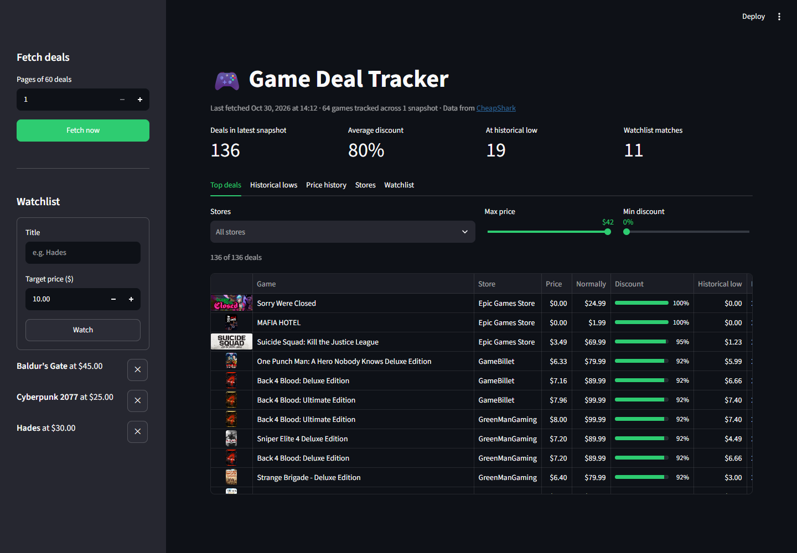
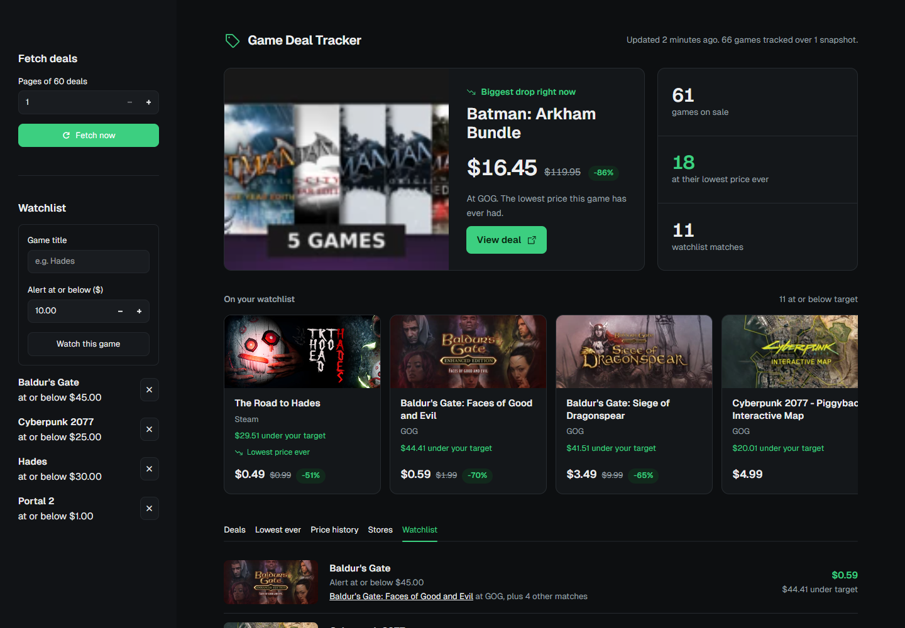
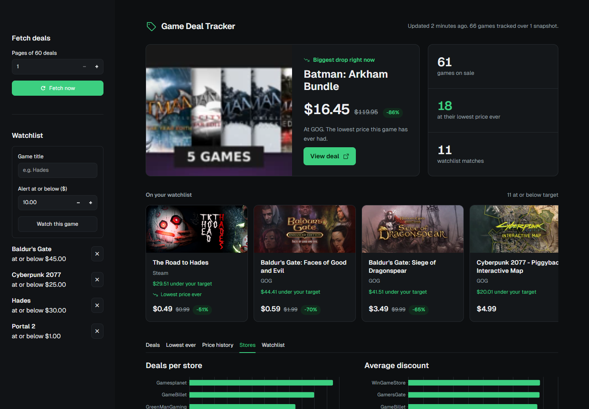

# Game Deal Tracker

[](https://github.com/JMScripts1/game-deal-tracker/actions/workflows/tests.yml)

[](LICENSE)

**[Project site](https://jmscripts1.github.io/game-deal-tracker/)**

A PC game deal tracker built on the [CheapShark API](https://apidocs.cheapshark.com). It collects deals from more than 30 storefronts, stores timestamped price snapshots in SQLite, and sends a Discord alert when a game on your watchlist drops to your target price. You can use it from the command line or through a web dashboard.



## Features

- **Watchlist alerts**: set a target price for any game. Each fetch looks up watched games directly, so they're tracked even when they aren't among the top deals.
- **Discord notifications**: alerts go to a Discord channel through a webhook, with cover art, a link to the deal, and a note when the price is a historical low.
- **No repeat alerts**: each game alerts once when it reaches your target, and again only if the price drops further or rises above the target and comes back down.
- **Historical lows**: uses CheapShark's record of each game's lowest price ever, so you can tell a real low from a routine sale on the first fetch.
- **Price history**: every fetch is stored as a snapshot, so you can chart how a game's price changes across stores.
- **Dashboard**: a Streamlit app with filterable deals, price history charts, store comparisons, and watchlist management.
- **Scheduled fetching**: a built-in scheduler collects snapshots on an interval you choose.

## Requirements

- Python 3.10 or newer
- An internet connection (CheapShark needs no API key)

## Installation

```bash
git clone https://github.com/JMScripts1/game-deal-tracker.git
cd game-deal-tracker

python -m venv venv
# Windows
venv\Scripts\activate
# macOS / Linux
source venv/bin/activate

pip install -r requirements.txt
```

## Quick start

```bash
python main.py init                          # create the database and load the store list
python main.py watch add "Baldur's Gate 3" 40  # alert when it's $40 or less
python main.py fetch                         # take a snapshot and check the watchlist
streamlit run dashboard.py                   # open the dashboard in your browser
```

## Dashboard

```bash
streamlit run dashboard.py
```

The dashboard opens at `http://localhost:8501`. From it you can:

- Browse the latest deals, filtered by store, maximum price, and minimum discount
- See which deals are at their historical low
- Search for a game and chart its price at each store over time
- Compare deal counts and average discounts across stores
- Add and remove watchlist entries, and see which watched games are at or below target
- Fetch a new snapshot with one click

| Watchlist | Stores |
| --- | --- |
|  |  |

## Discord alerts

1. In Discord, open **Channel settings → Integrations → Webhooks** and create a webhook. Copy its URL.
2. Copy `.env.example` to `.env` and paste the URL in:

   ```env
   DISCORD_WEBHOOK_URL=https://discord.com/api/webhooks/...
   ```

3. Check that it works:

   ```bash
   python main.py test-discord
   ```

From then on, `fetch`, `schedule`, and the dashboard's **Fetch now** button send new watchlist alerts to that channel. Alerts always print in the terminal too. If Discord can't be reached, the alert is retried on the next fetch.

## Command-line usage

| Command | Description |
| --- | --- |
| `python main.py init` | Create the database and sync store names from CheapShark. |
| `python main.py fetch [--pages N] [--no-alerts]` | Fetch `N` pages of 60 deals (default 1) plus every watched game, store them as one snapshot, and send new alerts. |
| `python main.py top [--limit N]` | Biggest discounts in the latest snapshot, with each game's historical low. |
| `python main.py stores` | Deal count, average discount, and cheapest deal for each store. |
| `python main.py history "<title>"` | Every recorded price for games whose title contains the search text. |
| `python main.py lows [--limit N]` | Deals that match or beat the game's historical low. |
| `python main.py watch add "<title>" <price>` | Watch a title. Adding a title that's already watched updates its target price. |
| `python main.py watch remove "<title>"` | Stop watching a title. |
| `python main.py watch list` | List watched titles and their target prices. |
| `python main.py watch check` | Show every deal at or below a watched target in the latest snapshot. |
| `python main.py test-discord` | Send a test message to your Discord webhook. |
| `python main.py schedule [--hours H] [--pages N]` | Fetch right away, then every `H` hours (default 6). Press `Ctrl+C` to stop. |

### How watchlist matching works

A watchlist entry matches any game whose title contains it **as whole words**, ignoring case:

- `Hades` matches *Hades*, *Hades II*, and *The Road to Hades*, but not *Cool Shades*.
- `Cyberpunk 2077` matches the base game and its DLC, such as *Cyberpunk 2077: Phantom Liberty*.

Use a more specific title to narrow the matches.

### Example

```text
$ python main.py watch add "Baldur's Gate" 45
Watching 'Baldur's Gate' at $45.00 or less.

$ python main.py fetch
Fetching at 14:10:17...
Done: 38 new games, 84 snapshots stored.
=== Watchlist alerts ===
Baldur's Gate: Siege of Dragonspear: $3.49 at GOG (target $45.00, normally $9.99)
Baldur's Gate II: Enhanced Edition: $5.99 at GOG (target $45.00, normally $19.99)
Baldur's Gate 3: $41.99 at GOG (target $45.00, normally $59.99) - historical low!

$ python main.py fetch
Fetching at 14:10:34...
Done: 0 new games, 84 snapshots stored.
```

The second fetch sends no alerts because none of the prices changed.

## Configuration

Settings are read from environment variables or from a `.env` file in the project folder (see `.env.example`).

| Variable | Default | Description |
| --- | --- | --- |
| `DISCORD_WEBHOOK_URL` | *(unset)* | Discord webhook for watchlist alerts. Without it, alerts only print in the terminal. |
| `DEALS_DB` | `deals.db` | Path to the SQLite database. |

## Project structure

```text
├── main.py              # CLI entry point (argparse subcommands)
├── dashboard.py         # Streamlit dashboard
├── fetch.py             # CheapShark API client with retries
├── fetch_and_store.py   # Fetches deals and watched games, writes snapshots to SQLite
├── db_setup.py          # Connection helper, schema, and title matching
├── queries.py           # Reports, each returned as a pandas DataFrame
├── alerts.py            # Works out which watchlist hits are new
├── notify.py            # Terminal and Discord alert delivery
├── watchlist.py         # Watchlist add / remove / list
├── run.py               # Fetch-and-alert cycle and interval scheduler
├── tests/               # pytest suite, including dashboard smoke tests
└── .github/workflows/   # CI: runs the tests on Python 3.10–3.14
```

## Data model

| Table | Purpose |
| --- | --- |
| `stores` | CheapShark store IDs and names. |
| `games` | One row per game, with its historical low price and date, and cover art URL. |
| `deals` | One row per deal per fetch: sale price, normal price, discount, and `fetched_at` timestamp. |
| `watchlist` | Watched title searches and their target prices. |
| `alerts_sent` | The price each watched game was last alerted at. Used to avoid sending the same alert twice. |

Reports and the dashboard use only the most recent snapshot, so a deal is counted once no matter how many fetches have run. Price history uses every snapshot. Listings at full price are left out of deal reports, but they're still checked against your watchlist targets.

## Running tests

```bash
pytest
```

The suite uses temporary SQLite databases and mocked API responses, so it never calls CheapShark or Discord. It also renders the dashboard headlessly with Streamlit's testing API. GitHub Actions runs it on every push and pull request.

## Notes

- **Historical lows** come from CheapShark's records, and are lowered further if the tracker sees a cheaper price later.
- **Rate limits**: CheapShark is a free service that limits request rates. The default 6-hour schedule stays well within its limits; please don't fetch aggressively. Failed or rate-limited requests are retried with backoff.
- Deal data is provided by [CheapShark](https://www.cheapshark.com). This project is not affiliated with CheapShark or any of the storefronts it tracks.

## License

Released under the [MIT License](LICENSE). You're free to use, modify, and share the code, including in commercial projects, as long as the license notice is kept.
